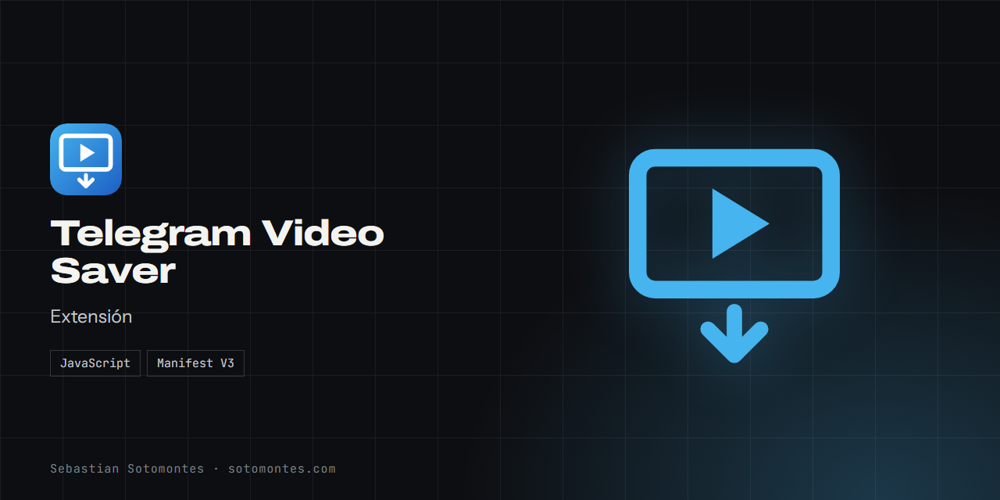

Extensión de navegador que guarda en tu equipo los videos que ya puedes ver en Telegram Web.

<a href="https://sotomontes.com/#telegram-video-saver"><b>Ver en sotomontes.com</b></a> · <a href="#cómo-se-usa">Cómo se usa</a> · <a href="#cómo-funciona-por-dentro">Cómo funciona</a> · <a href="#novedades">Novedades</a>

| Ficha técnica | |
|---|---|
| **Autor** | Sebastian Sotomontes |
| **Tipo** | Extensión |
| **Plataforma** | Extensión para Edge |
| **Versión** | 1.0 |
| **Estado** | Funcional |
| **Stack** | JavaScript · Manifest V3 |
| **Código** | Privado. Esta página es solo una presentación. |

---

## Qué es

Extensión para Microsoft Edge que guarda en tu equipo los videos que ya puedes ver en Telegram Web.

## Novedades

- Descarga por bloques con reintentos y guardado directo a disco.

## Cómo se usa

1. Carga la extensión en Edge en modo de desarrollador.
2. Entra a Telegram Web y recarga la pestaña.
3. Reproduce el video en el chat. Basta con que empiece a cargar.
4. Abre el botón flotante de la esquina.
5. Pulsa **Descargar**.
6. Para videos grandes activa **Elegir dónde guardar**.

## Funciones

- **Botón flotante** dentro de Telegram Web.
- **Descarga por bloques** con reintentos.
- **Barra de progreso** por video.
- **Guardado directo a disco** para videos grandes.

## Detalles

- Sin la opción de guardar en disco, el archivo se arma en memoria antes de guardarse.

## Privacidad y seguridad

Solo funciona con el contenido que tu cuenta puede ver y cargar.

## Cómo funciona por dentro

### Arquitectura

### Cómo funciona

Telegram Web no expone un archivo directo: su service worker reconstruye el video y lo entrega por una ruta interna que responde a peticiones por rangos. La extensión lee esa fuente, obtiene nombre, tamaño y tipo, y pide el archivo en bloques de 1 MiB con reintentos. Los videos ya cargados en memoria se copian directamente.

---

© 2026 Sebastian Sotomontes. Todos los derechos reservados.
